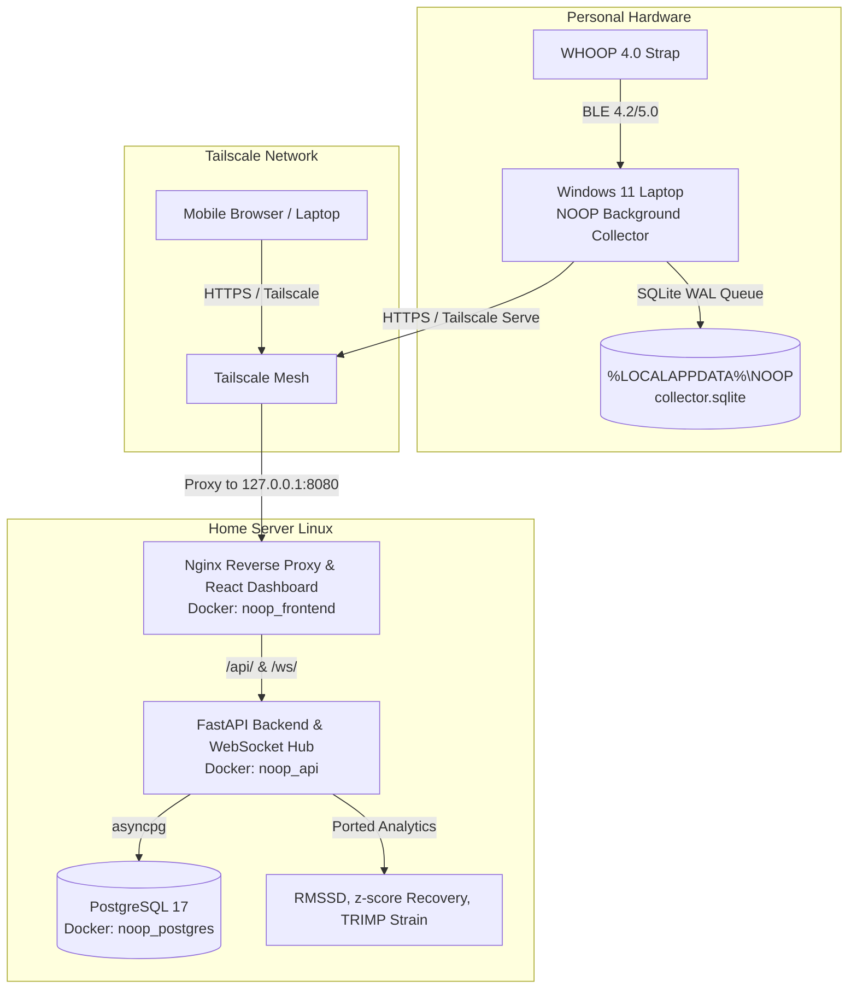

# NOOP Home Lab — Complete Production Operations Runbook

This runbook is the definitive operational manual for deploying, running, and maintaining the self-hosted NOOP Home Lab platform.

---

## 1. System Architecture

The NOOP Home Lab platform is an offline-by-default, self-hosted companion system for the WHOOP 4.0 fitness band.



### Component Boundaries
- **Bluetooth Gateway**: The Windows 11 laptop exclusively owns the BLE connection. The home server has no Bluetooth hardware requirements.
- **Durable Local Staging**: If the home server or Tailscale network is offline, the Windows collector stores all raw BLE frames and decoded records in local SQLite in WAL mode. Nothing is discarded.
- **Persist-Before-ACK**: Historical on-strap memory is cleared only after SQLite write confirmation.
- **Zero Cloud Exposure**: The database is inaccessible outside the internal Docker network. Web and API traffic is bound to `127.0.0.1:8080` on the Linux host and routed exclusively through Tailscale Serve.

---

## 2. Linux Home Server Deployment Runbook

### Prerequisites
- Linux host running Ubuntu 22.04+, Debian 12+, Arch, or similar.
- Docker Engine 24.0+ & Docker Compose v2 installed.
- Tailscale installed and authenticated on your personal Tailnet.

### Step 1: Clone Repository & Configure Environment
```bash
# Clone your private fork
git clone https://github.com/fionnhourican/noop.git
cd noop/homelab

# Initialize production environment configuration
cp .env.example .env
```

Generate cryptographically secure tokens:
```bash
# Generate database password (min 24 chars)
openssl rand -hex 16

# Generate Windows ingestion bearer token (min 32 chars)
openssl rand -hex 32

# Generate dashboard access token
openssl rand -hex 24
```

Edit `homelab/.env` with your editor of choice:
```ini
POSTGRES_USER=noop
POSTGRES_PASSWORD=your_generated_postgres_password
POSTGRES_DB=noop_homelab

INGESTION_TOKEN=your_generated_ingestion_bearer_token
DASHBOARD_TOKEN=your_generated_dashboard_token
ENVIRONMENT=production
```

### Step 2: Launch Docker Compose Services
```bash
cd homelab
docker compose up -d --build
```

Verify service health:
```bash
docker compose ps
```
Expected output:
- `noop_postgres`: `Up (healthy)`
- `noop_api`: `Up`
- `noop_frontend`: `Up`

### Step 3: Run Alembic Database Migrations
Database tables are initialized and managed via Alembic:
```bash
docker compose exec api alembic upgrade head
```

Verify schema creation:
```bash
docker compose exec postgres psql -U noop -d noop_homelab -c "\dt"
```
Required tables: `devices`, `raw_frames`, `source_records`, `heart_rate_samples`, `biometric_records`, `sleep_sessions`, `sleep_stages`, `recovery_metrics`, `strain_metrics`, `workouts`, `collector_status`, `sync_batches`.

### Step 4: Configure Tailscale Serve (HTTPS)
Expose the local Nginx dashboard securely on your private Tailnet:
```bash
sudo tailscale serve --bg http://127.0.0.1:8080
```

Verify Tailscale Serve status:
```bash
tailscale serve status
```
Your service will be reachable across your Tailnet at:
`https://your-server-hostname.your-tailnet.ts.net`

---

## 3. Windows 11 Collector Deployment Runbook

### Step 1: Strap Bluetooth Pairing
1. Disconnect WHOOP from any mobile app or turn off smartphone Bluetooth.
2. Double tap the top of the WHOOP 4.0 until the side LED pulses blue (pairing mode).
3. In Windows 11, open **Settings -> Bluetooth & devices -> Add device -> Bluetooth**.
4. Select your WHOOP 4.0 to establish OS-level bonding.

### Step 2: Install the Background Collector Agent
Open PowerShell as your standard user:
```powershell
cd C:\path\to\noop\Tools\windows-capture

# Install Python requirements
pip install -r requirements.txt

# Run installer script
.\install.ps1 `
    -ServerUrl "https://your-server-hostname.your-tailnet.ts.net/api/v1" `
    -IngestionToken "your_generated_ingestion_bearer_token"
```

The script will:
1. Create `%LOCALAPPDATA%\NOOP\` with locked DACL permissions (restricted to current user).
2. Store your ingestion token securely in Windows Credential Manager under `NOOP_HomeLab_Ingestion`.
3. Register a Task Scheduler job to run windowlessly (`pythonw.exe`) at user logon.

### Step 3: Verify System Tray Operation
Start the background task:
```powershell
Start-ScheduledTask -TaskName "NOOP_HomeLab_Collector"
```
The NOOP icon will appear in your system tray:
- **Green**: Connected to WHOOP 4.0 & streaming live HR.
- **Yellow**: Scanning for strap or synchronizing backlog.
- **Grey**: Disconnected / Waiting for strap in range.
- **Red**: Error (check `%LOCALAPPDATA%\NOOP\logs\collector.log`).

Right-click the tray icon to:
- Trigger **Synchronise Now**.
- Pause / Resume collection.
- View real-time log stream.

---

## 4. Daily Backups & Disaster Recovery

### Automated Nightly Backups
Configure a cron job on your Linux home server:
```bash
crontab -e
```
Add the following line (runs daily at 03:00 UTC):
```cron
0 3 * * * /path/to/noop/homelab/scripts/backup.sh >> /var/log/noop_backup.log 2>&1
```

### Manual Backup
```bash
cd homelab
./scripts/backup.sh
```
Backups are saved to `homelab/backups/noop_backup_<timestamp>.sql.gz`. Retention is automatically enforced (default 30 days).

### Verifying a Backup
```bash
./scripts/verify_backup.sh homelab/backups/noop_backup_<timestamp>.sql.gz
```
Checks:
1. File size > 100 bytes.
2. Gzip archive decompression CRC.
3. SQL stream schema validation (all required tables).
4. SHA-256 fingerprint generation.

### Restoring from Backup
```bash
./scripts/restore.sh homelab/backups/noop_backup_<timestamp>.sql.gz
```
Enter `yes` when prompted to confirm restoring.

---

## 5. Troubleshooting Playbooks

### Playbook A: Strap Reconnection Stalled
**Symptoms**: Windows agent tray icon remains grey or yellow; log shows `Connection attempt unfulfilled`.
1. Ensure the WHOOP band is charged and awake (tap sensor; green LEDs should illuminate).
2. Check Windows Bluetooth settings: ensure Bluetooth is ON.
3. If Windows reported `BluetoothDevice.FromIdAsync failed`, turn Bluetooth OFF in Windows Settings, wait 5 seconds, and turn it back ON.
4. The agent supervisor incorporates exponential backoff and will reconnect automatically once the adapter is ready.

### Playbook B: Draining Queue Backlog After Travel
**Symptoms**: Laptop was away from home server for days; queue shows hundreds or thousands of pending records.
1. Reconnect your Windows laptop to Tailscale.
2. Right-click the NOOP system tray icon and click **Synchronise Now**.
3. The sync worker will pull batches (default 100 records per batch) and continuously stream them until the queue count reaches 0.
4. Because the server uses transactional batch idempotency, any duplicate records that were previously uploaded are safely ignored with zero double-counting.

### Playbook C: Home Server Container Recreation
**Symptoms**: Server rebooted or `docker compose down` was run.
1. Run `docker compose up -d` in `homelab/`.
2. PostgreSQL data persists across container lifecycles via the named Docker volume `noop_postgres_data`.
3. The Windows agent will automatically retry uploads with full jitter and resume streaming as soon as the server is up.
